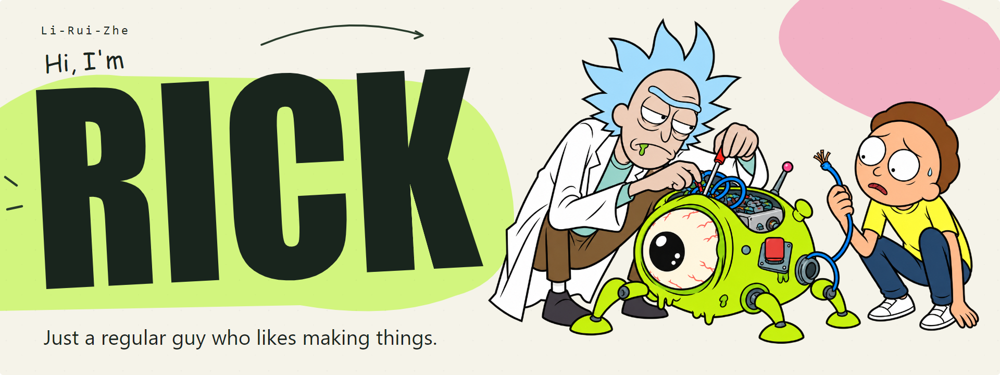

<a href="./README.md">中文</a> | <strong>English</strong>

  <picture>
    <source media="(prefers-color-scheme: dark)" srcset="assets/header-en-dark.png" />
    
  </picture>

**I want to build something people love.**

[✍️ My blog · Rick's Little Universe (in Chinese)](https://blog.liruizhe.cc/)

### Hey, I'm Rick 👋

Just a regular guy who likes tinkering with new things.

I'm curious about what makes a good product and what we can do with AI. Weird ideas pop into my head all the time. If one sounds fun, I usually try building it.

I've always wanted to build a product people love and keep coming back to.
