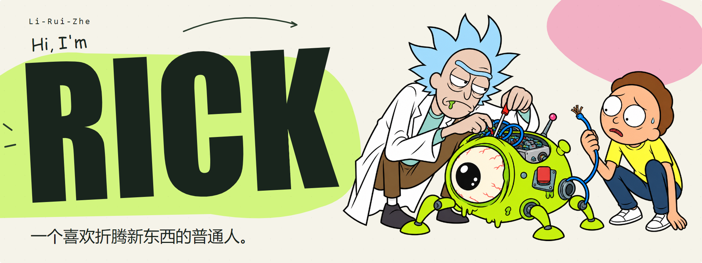

  <picture>
    <source media="(prefers-color-scheme: dark)" srcset="assets/header-dark.png" />
    
  </picture>

**I want to build something people love.**

[✍️ 我的博客 · Rick 的小宇宙](https://blog.liruizhe.cc/)

### 嗨，我是 Rick 👋

一个喜欢折腾新东西的普通人。

平时喜欢研究产品，也喜欢 AI。脑子里经常冒出一些奇奇怪怪的想法，有意思的就动手做做。

一直想做出一款真正有人喜欢、愿意一直用下去的产品。

About me in English

### Hey, I'm Rick 👋

Just a regular guy who likes tinkering with new things.

I'm curious about what makes a good product and what we can do with AI. Weird ideas pop into my head all the time. If one sounds fun, I usually try building it.

I've always wanted to build a product people love and keep coming back to.

[✍️ My blog · Rick's Little Universe (in Chinese)](https://blog.liruizhe.cc/)

